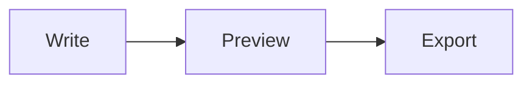

# Using MD Preview

MD Preview runs locally in your browser. See [README.md](../README.md) for setup.

## Features

### Writing

- Live preview as you type, with GitHub Flavored Markdown and line breaks preserved
- Line-number gutter and optional scroll sync between editor and preview
- Built-in markdownlint checks for eight Markdown rules, with line navigation, individual fixes, and Fix all safe issues
- Auto-save of your document and preferences, including custom themes, display settings, and pane layout
- Visible save status and a download action if browser storage cannot save your draft
- Draft history with up to 20 local recovery versions; edits from another tab pause autosave until you choose which version to keep
- A heading outline and source find/replace for navigating long documents
- Local completion for Markdown constructs, document links, and JavaScript, TypeScript, JSON, HTML, CSS, and Python fences (Complete or <kbd>Ctrl/Cmd+Space</kbd>)
- Offline use through a service worker; when a new version is deployed, an **Update available** toast offers a reload instead of swapping code mid-edit
- A rich starter document that shows off what the editor can render

### Rendering

- Syntax-highlighted code blocks via [highlight.js](https://highlightjs.org/), themed to match light or dark mode
- Math with [KaTeX](https://katex.org/) and diagrams with [Mermaid](https://mermaid.js.org/)
- YAML frontmatter at the top of a file shown as a small metadata table, like GitHub
- Fullscreen viewer for images and diagrams
- Optional blocking of remote images, with alt-text placeholders and a **Load images** button
- Mermaid diagram toolbar to view full screen, copy as PNG, or download as PNG
- All rendered HTML sanitized with [DOMPurify](https://github.com/cure53/DOMPurify)

### Import and export

- **Citations** opens tools to add a custom source or paste an AI response with source links. Review the recovered Markdown and links before inserting; edits use the editor's undo/recovery support.
- The separate **Citation playground** is available at `/citation-playground.html` (also linked from Citations). It uses the same importer, with Markdown copy/download and self-contained HTML download.

- Import `.md`, `.markdown`, or `.txt` files with the file picker or by dragging a file onto the editor (you're asked before your current content is replaced)
- Export as:
  - **Markdown** (`.md`) source
  - **HTML**: a self-contained file with embedded styles and optional base64-inlined images
  - **PDF** through the browser's print dialog (choose "Save as PDF")

### Keyboard shortcuts

Use <kbd>Cmd</kbd> on macOS and <kbd>Ctrl</kbd> on Windows and Linux. Document shortcuts and file dropping are paused in Settings; shortcuts are also paused while a dialog is open.

| Shortcut                  | Action                                                  |
| ------------------------- | ------------------------------------------------------- |
| <kbd>Cmd/Ctrl+O</kbd>     | Import a file                                           |
| <kbd>Cmd/Ctrl+S</kbd>     | Download the document as `.md`                          |
| <kbd>Cmd/Ctrl+Space</kbd> | Show local completion suggestions                       |
| <kbd>Cmd/Ctrl+\\</kbd>    | Collapse or expand the editor (not available on mobile) |

### Layout

- Resizable split panes (drag the handle, or focus it and use the arrow keys)
- Collapsible editor for distraction-free reading
- System, light, and dark appearances
- Six selectable pastel palettes, each with light and dark appearances; your choice is saved locally
- Website themes and display settings stay separate from HTML/PDF exports and browser printing
- Responsive layout with editor/preview tabs on mobile

### Settings

Open **Settings** beside Export on desktop, or from the **More options** menu on mobile. **Back to editor** returns to the same document, selection, undo history, and pane layout. Browser Back/Forward works too. Settings links can be bookmarked, for example `/?view=settings&section=writing`.

- **Appearance:** choose System/Light/Dark independently of your theme, select Warm Paper or one of six pastels, create and manage custom themes, adjust interface scale (90–125%), and enable a neutral high-contrast scheme.
- **Writing:** adjust editor and preview text sizes separately (80–160%) and line spacing (1.2–2.2), and control Markdown linting, automatic suggestions, and scroll sync.
- **Privacy:** control remote-image blocking and read how it affects external images.

Preferences apply immediately and save locally. **Create theme** starts from an existing theme with separate light/dark colors for workspace, editor, reading surface, text, secondary text, accent/link, highlight, and border. Color edits affect the dialog sample until you create or save the theme. Custom themes can be edited, renamed, duplicated, or deleted; built-in themes stay unchanged. Contrast warnings help identify difficult combinations and allow saving. Unsaved theme edits require a discard decision.

**Reset preferences** restores System appearance, Warm Paper, normal contrast, 100% sizes and interface scale, editor/preview line spacing of 1.70/1.75, linting off, suggestions on, scroll sync off, and remote-image blocking off. It preserves documents, history, custom themes, and pane layout. Reset and theme-editing controls use fixed readable colors. If browser storage fails, changes remain usable for the session and Settings reports that they could not be saved.

These visual choices affect the website only, including the Citation playground. HTML, PDF, direct browser printing, and playground downloads keep their existing document styling. Settings and custom-theme creation work offline after installation.

## Supported syntax

Everything in [GitHub Flavored Markdown](https://github.github.com/gfm/) (tables, task lists, strikethrough, autolinks, fenced code), plus:

````markdown
Inline math: $E = mc^2$

$$
\int_0^\infty e^{-x^2}\,dx = \frac{\sqrt{\pi}}{2}
$$


````

### Citation chips and AI copy/paste

Use a normal Markdown link with the title `"cite"` to display a source chip:

```markdown
A cited claim. [Source](https://example.org/paper 'cite')

Another claim. [Source][paper]

[paper]: https://example.org/paper 'cite: Optional article title'
```

The URLs above are illustrative. Replace them with the exact cited pages. Other Markdown tools display working links; chip styling is specific to this app. **Add citation** in the editor and **Add a custom citation** in the playground provide forms for entering a URL, label, and optional article title.

For copied AI responses, choose **Citations → Paste with citations**. Paste a full response into the input, compare copied text with the formatted copy when both are available, and check source links under **Review source links** to turn them into chips. You can also edit their labels. Click **Insert response** when the preview is ready. Regular paste accepts Markdown directly, including the citation format above. The playground offers the same review workflow without editing the current draft.

**Copy AI prompt** asks an AI to include real source URLs using this format. Rich copied content can retain headings, tables, lists, and code. A linked superscript or explicit citation marker can become a chip automatically; an ambiguous link remains an ordinary link until you choose it. Missing URLs and unmapped provider citation IDs cannot be reconstructed and are reported for repair. Source preservation does not verify whether a source supports a claim.

Both tools run locally without fetching source metadata. Markdown and HTML exports preserve citation links. The standalone page opens offline after service-worker installation; rich conversion becomes available offline after it has loaded once. Its working text lives only in the current tab, so copy or download it before closing.

### Lint rules

Linting is off by default; turn it on in **Settings → Writing**. It uses [markdownlint](https://github.com/DavidAnson/markdownlint) with these eight standard rules:

| Rule  | Checks for                             |
| ----- | -------------------------------------- |
| MD009 | Trailing spaces                        |
| MD010 | Hard tabs                              |
| MD012 | Multiple consecutive blank lines       |
| MD018 | No space after `#` in a heading        |
| MD022 | Headings not surrounded by blank lines |
| MD037 | Spaces inside emphasis or bold markers |
| MD041 | First line isn't a top-level heading   |
| MD047 | File doesn't end with a newline        |

Only warnings with a known fix show **Fix**. **Fix all safe issues** rechecks the latest draft and skips tab replacements inside code blocks. Standard MD010 still reports tabs in code; you can fix those individually. Linting runs locally in a worker.

Automatic completion is on by default and can be turned off in **Settings → Writing**. <kbd>Ctrl/Cmd+Space</kbd> and **Complete** remain available. Code suggestions use syntax and names already written in the current fence; unsupported fences suggest earlier words from that fence. Selected Markdown text can be wrapped with a completion. All completion languages are available offline after the first completed service-worker installation. No AI or network service handles the draft.

Quick fixes and completions support native undo where available. If the browser cannot provide it, the editor saves a recovery copy in **History** before applying the edit. The edit is canceled if that copy cannot be saved.

## Privacy and security

- Your markdown and settings stay on your device. Nothing is sent to a server.
- The production site ships a strict Content Security Policy (see [`_headers`](../_headers)): scripts, fonts, and network connections are limited to the same origin, and the app can't be embedded in frames.
- Images referenced in your markdown by URL are fetched from those URLs by default, which reveals your IP address to their hosts. Turn on **Block remote images** in **Settings → Privacy** to stop this: remote images (including ones in raw HTML, inline styles, and Mermaid diagrams) show as placeholders with their alt text, and **Load images** loads them for the current document. Images from the same site and `data:` URLs always load.
- If `localStorage` is unavailable (for example, in some private browsing modes), the app still works but won't remember your content or settings.

To report a vulnerability, see [SECURITY.md](../SECURITY.md).
